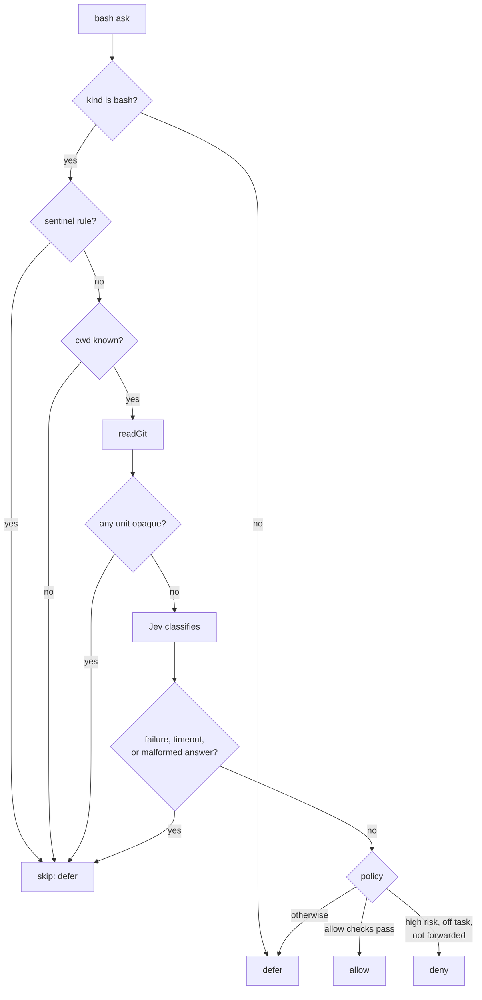

# jev-gate

Authorizer link `jev` for pi-permission-system. It answers bash `ask` requests with the Jev classifier: **allow**, **deny**, or **defer** (hand the ask to the user). Defer is the fail-safe: every failure, unknown, and missing value ends in defer.

Enable with `"authorizerChain": ["jev"]` in `extensions/pi-permission-system/config.json`. Check with `bun extensions/jev-gate/check.ts`.

## Files

| File | Holds |
| --- | --- |
| `index.ts` | Pi event wiring and `MODE` (`live` acts on verdicts, `shadow` always defers and logs). The only file that imports `@earendil-works/pi-coding-agent`. |
| `gate.ts` | All logic: guards, context, questions, policy, `createAuthorizer`. Imports only `node:` modules. |
| `check.ts` | Self-check; one `ok:` line per behaviour. |

## Trust model

The agent writes the command. Everything else Jev reads is operator-authored:

- **Guidance** is snapshotted at `session_start`. Project files count only when trusted and unmodified since HEAD (their committed text is used). The global `AGENTS.md` is read from disk.
- **`allowBlocked`** is a reason string that forbids allow when the agent could have written context Jev reads: no full command (`ask_unit_only`), a shell comment, or a heredoc.
- **Redaction** runs on the command, prompts, and guidance before they reach Jev.

## Judgement flow

- **Sentinel rules** (`<opaque-bash-wrapper>`, …) mean the permission system could not see what runs.
- **Opaque** means Jev cannot see the code that runs. Every unit is checked, including `askingUnits`: scripts and paths (`./x.sh`, `python x.py`); unpinned downloaders (`npx pkg`, not `npx pkg@1.2.3`); task runners (`npm`, `make`, …) whose definition file is uncommitted, or any task runner when git state is unknown.
- **Jev** gets the command plus recent user prompts, the guidance snapshot, and git state. `QUESTIONS` defines what it answers.
- **Policy** reads the answers:
  - **allow** needs low expected risk, low tail risk (P(risk ≥ medium)), enough confidence, every flag clear, and `allowBlocked` null.
  - **deny** needs high expected risk and a command off the user's task. Forwarded asks never deny: they carry no task prompt.
  - Everything else defers.

## Logs and tuning

Thresholds sit at the top of `gate.ts`. Skips log `jev_gate.skipped` with a `reason`; verdicts log `jev_gate.verdict` with every policy input, the thresholds, `policyVersion`, and `questionsHash`, so any verdict replays offline. When a change to the policy or questions alters verdicts, bump `POLICY_VERSION`; `questionsHash` already records question edits.

Log field names avoid the words secret, token, credential, and key: the permission log masks values under such names.

Log file: `extensions/pi-permission-system/logs/pi-permission-system-permission-review.jsonl`.
